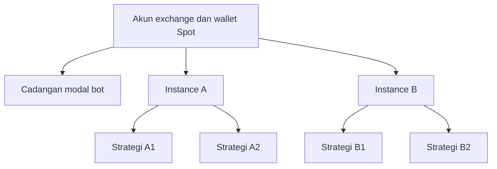

# Rancangan multi-instance dalam satu akun exchange

Tanggal: **20 Oktober 2026**. Status: **rancangan dengan implementasi lokal Plan 2**.
Kontrak yang tersedia dan batas praktis ada di [panduan runtime](managed-runtime.md);
model ini diwujudkan sebagai agregat JSONB/jurnal, bukan tabel SQL per entitas. Urutan pengerjaan dan status ada di
[Plan 2](plan-2.md). Dokumen ini menjelaskan model yang disepakati agar istilah
instance tidak tertukar dengan proses/container atau ID strategi lama.

## Struktur produk

Satu akun terhubung ke satu koordinator wallet dalam satu mode. Instance
adalah portofolio virtual yang mendapat sebagian modal bot; setiap instance
berisi satu atau beberapa strategi. Subakun exchange tidak diperlukan pada
versi awal. Pembatasan dana antar-instance ditegakkan oleh aplikasi dan tidak
mengubah kenyataan bahwa exchange melihat satu wallet.

Contoh **pembagian dana**, bukan rekomendasi strategi/portofolio:

| Bagian | Alokasi dari modal bot Rp2 juta | Penggunaan |
|---|---:|---|
| Instance A | Rp1 juta | Dua strategi berbagi pool instance |
| Instance B | Rp600 ribu | Satu atau beberapa strategi lain |
| Cadangan | Rp400 ribu | Belum tersedia untuk strategi |

Aplikasi mencatat nilai dalam aset asli (misalnya USDT), memakai decimal.
Rupiah/USD adalah tampilan dengan kurs bertanggal. Seluruh saldo pribadi di
exchange tidak otomatis dijadikan modal bot, dan keuntungan simulasi tidak
menjadi saldo riil. Contoh Rp2 juta tidak berarti setiap instance diberi Rp2 juta.

## Identitas dan kepemilikan

| Entitas rancangan | Arti |
|---|---|
| Akun exchange | Identitas koneksi/kredensial; secret disimpan terpisah dari laporan |
| Wallet/pool | Akun + mode + market + aset pendanaan; Spot/Futures tidak disatukan |
| Instance bot | ID stabil, nama, wallet, lifecycle, konfigurasi dan alokasi |
| Strategy binding | Pemasangan satu versi strategi/parameter/pair pada satu instance |
| Run/session | Eksekusi bertanggal; restart membuat run baru, tidak menciptakan modal baru |
| Order/fill | Punya pemilik instance dan binding serta ID exchange yang bisa dideduplikasi |
| Posisi/lot ledger | Kepemilikan virtual per binding dan instrumen, terpisah dari agregat exchange |
| Jurnal/reservasi | Perubahan dana dan penguncian aset yang dapat dipulihkan setelah crash |

`strategy_runs.instance_id` lama berisi identitas strategi/sesi, bukan definisi
instance baru. Jangan mengganti artinya tanpa migrasi eksplisit. Simpan referensi
run asal dan history; mode dan akun harus ikut dalam namespace pencarian resume.

## Aturan modal yang wajib dijaga

1. Alokasi awal dan transfer menulis debit/kredit berpasangan dalam satu transaksi
   database. Pengulangan request memakai idempotency key, bukan transfer kedua.
2. Cadangan + seluruh alokasi awal sama dengan modal bot yang benar-benar
   didanai. Sesudah trading, nilai bot adalah cadangan ditambah equity instance,
   disesuaikan setoran/penarikan/fee/PnL; jangan memaksa equity selalu sama dengan
   modal awal atau memasukkan laba dua kali.
3. Batas anggaran strategi bukan saldo tambahan. Default satu pool instance;
   batas opsional membatasi pemakaian masing-masing strategi, sedangkan
   pemeriksaan saldo/risiko tetap menghitung seluruh strategi bersama.
4. Transfer internal hanya menggunakan tunai bebas yang tidak dipesan dan
   benar-benar didukung wallet; nilai koin, unrealized profit dan dana order
   belum menjadi tunai bebas. Pengurangan alokasi ditolak jika dana terpakai.
5. Laba/rugi dan biaya tetap pada instance/strategi asal. Setoran/transfer bukan
   keuntungan; laporan return dan risk harus memperhitungkan arus modal.
6. Order buy memerlukan quote + buffer komisi; sell memerlukan base milik
   strategi. Spot tidak boleh short atau memakan inventori pribadi/instance lain.
7. OCO mengunci satu inventori bersama untuk dua leg alternatif. Partial fill
   menyesuaikan sisa reservasi; request cancel saja belum melepas dana.
8. Kapasitas wallet fisik menjadi batas tambahan. Deposit/withdrawal atau
   transaksi manual tidak boleh membuat instance membelanjakan dana yang hilang.

Pisahkan ukuran tunai, dana dipesan, biaya pokok inventori, nilai inventori dan
unrealized PnL. Ledger Plan 1 memakai balance termasuk realized PnL dengan
perhitungan margin; jangan mengganti label menjadi cash Spot tanpa mengaudit
rumus. Sizing instance memakai dananya sendiri, bukan total saldo akun.

## Koordinator akun dan eksekusi

Keputusan awal: **satu pemilik tulis aktif per wallet/mode**, bukan satu bot
independen per instance memakai API key yang sama. Koordinator membagi feed,
merutekan execution report, mengatur rate limit, dan memeriksa reservasi global.
Setiap instance/binding tetap memiliki state strategi dan limit masing-masing.
Lease/lock database dan fencing diperlukan agar worker lama yang kehilangan
kepemilikan tidak melanjutkan order.

Urutan transaksi yang harus dipulihkan:

1. Validasi scope, lifecycle, harga/aturan instrumen dan risk bertingkat.
2. Reservasi aset dan simpan intent/order dengan ID deterministik/idempoten.
3. Kirim ke exchange; jika respons ambigu, query status sebelum kirim ulang.
4. Terapkan fill/fee sekali dan perbarui jurnal, posisi serta reservasi.
5. Lepas sisa reservasi setelah status terminal terkonfirmasi.

Ada celah crash antara commit DB dan request jaringan. Desain pending intent,
retry/recovery dan deduplikasi wajib menjelaskannya; transaksi DB saja tidak
membuat request exchange atomik. Recorder asinkron lama tidak boleh menjadi
satu-satunya penyimpan reservasi yang menentukan apakah dana boleh digunakan.

Pada versi awal, order tetap milik satu binding dan tidak digabung/netting
antarstrategi. Dua strategi boleh memiliki ETH bersamaan pada ledger yang
terpisah; jumlah base yang dapat dijual tetap dibatasi agregat saldo exchange.
Satu exit hanya menutup bagiannya sendiri. Jika exchange menerapkan self-trade
prevention atau order tidak memenuhi minimum, tampilkan alasan/statusnya;
jangan memindahkan kepemilikan agar order tampak berhasil.

Futures/unified wallet/multi-leg memerlukan desain khusus dan pengujian lanjutan;
net position exchange dan leverage bersama tidak otomatis terisolasi oleh
pembukuan virtual ini.

## Reconciliation, restart dan perubahan eksternal

- Pulihkan alokasi/jurnal/reservasi, perintah tertunda, kepemilikan posisi,
  rencana proteksi/trailing dan state strategi sebelum menerima entry baru.
- Cocokkan aggregate aset/order milik bot dengan exchange; saldo pribadi tetap
  terpisah. Order yang tidak dikenal dilaporkan, bukan dibatalkan sembarang.
- Selisih tidak otomatis dibagi rata atau dibebankan ke instance terakhir.
  Catat bukti dan tahan aktivitas yang bisa memperbesar selisih; tetap izinkan
  proteksi/pengurangan risiko yang dapat ditentukan aman.
- Fee base, quote dan BNB dicatat dengan aset serta nilainya; perubahan karena
  rounding/dust memiliki jurnal, bukan menghilang dari kuantitas/PnL.
- Histori mode/run berbeda tidak boleh diadopsi hanya karena paling baru di DB.
  Dua worker aktif pada wallet sama ditolak, bukan saling menutup run.

## Risiko dan tindakan pengguna

Setiap order harus lolos batas strategi, instance, dan akun. Parent limit selalu
membatasi child; menaikkan batas strategi tidak menambah saldo instance.
Konsentrasi ETH dari beberapa strategi dihitung bersama di tingkat akun.

| Tindakan | Arti |
|---|---|
| Pause entry | Tidak membuka/menambah posisi; exit, proteksi dan reconciliation lanjut |
| Resume | Melanjutkan entry bila state sehat dan kill switch tidak aktif |
| Cancel pending | Membatalkan order sesuai scope; jika ada proteksi posisi, jelaskan dampaknya |
| Close/flatten | Batalkan order berkonflik dan tutup inventori milik scope; tunggu status final |
| Stop untuk resume | Berhenti dengan state tersimpan; order/posisi yang dipertahankan ditampilkan |
| Finish experiment | Selesaikan order dan kebijakan inventori, snapshot terminal, backup dan tutup run |
| Arsip instance | Hanya setelah order selesai dan posisi flat; history/jurnal dipertahankan |

Stop proses/container tidak dianggap sama dengan cancel order exchange.
Flatten gagal tetap `closing`/`needs_attention`, bukan ditampilkan selesai.
Pilih kebijakan inventori (tutup atau pertahankan) secara eksplisit saat
mengakhiri eksperimen. Level akun mengelola seluruh instance bot, tidak
mengizinkan menjual aset pribadi atau membatalkan order manual di luar scope.

## Dashboard dan laporan

Ringkasan akun menampilkan modal bot/cadangan, equity total, jumlah instance,
status koneksi/reconciliation dan exposure gabungan. Detail instance menampilkan
alokasi, saldo bebas/reserved, inventori, fee dan net PnL, drawdown, strategi,
order serta transfer. Strategi menampilkan alasan entry/exit/menunggu.

Kontrol web/Telegram wajib menyertakan scope stabil serta memeriksa otorisasi.
Pesan Indonesia dengan USDT dan perkiraan USD/IDR, timestamp kurs dan tingkat
notifikasi yang dipilih. Satu Telegram receiver merutekan ke instance;
filter/digest mengurangi spam. Template menduplikasi konfigurasi saja, tanpa
saldo, kredensial, ID order, posisi, risk peak atau history trial lama.

## Migrasi dan kriteria penerimaan

Migrasikan DB salinan lebih dahulu. Default lama menjadi satu instance legacy
per akun/mode dengan binding dari strategi yang ada. Jangan menganggap saldo
10.000 USDT testnet sebagai modal riil Rp2 juta. Ownership ambigu ditandai untuk
review; tidak menebak pembagian atau mereset sesi lama. Dokumentasikan batas
rollback apabila schema baru sudah menerima transaksi.

Fase testing [Plan 2](plan-2.md#p2-7--testing-menyeluruh) harus membuktikan:

- Dua alokasi/transfer/order serentak tidak menghabiskan dana yang sama.
- Dua strategi pada koin sama tidak mengambil posisi/proteksi satu sama lain.
- Partial fill, replay, cancel ambigu dan crash tidak menggandakan dana/fee.
- Risk/kill dan pause scoped tidak menghentikan atau menjual scope lain.
- Restart membangun state konsisten dan hanya satu pemilik wallet aktif.
- Jumlah ledger/jurnal sesuai dana bot, fee dan arus eksternal yang diketahui;
  perubahan modal tidak menghasilkan profit fiktif.
- Backtest bersama memakai modal total yang sama, tidak menjumlahkan hasil
  pengujian Rp2 juta per kombinasi menjadi satu portofolio Rp2 juta.
